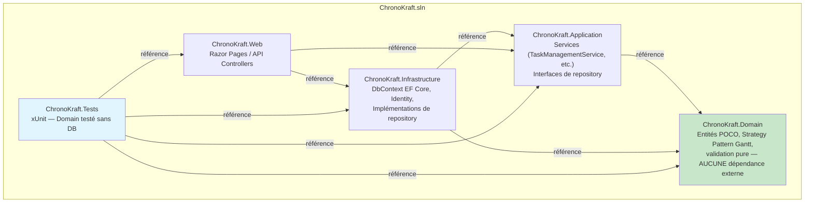
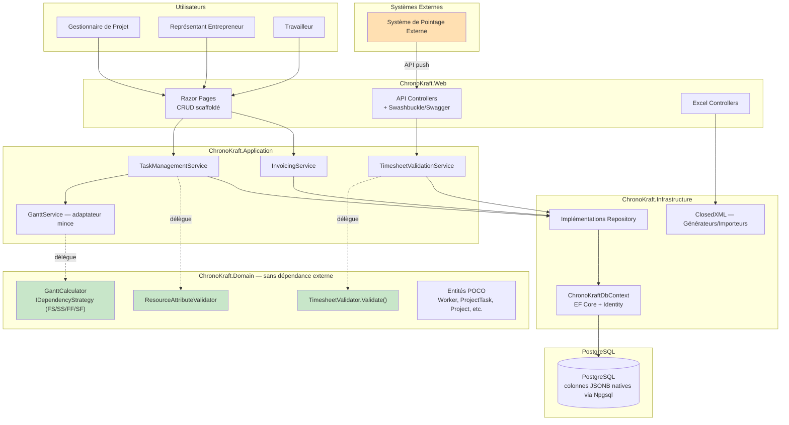
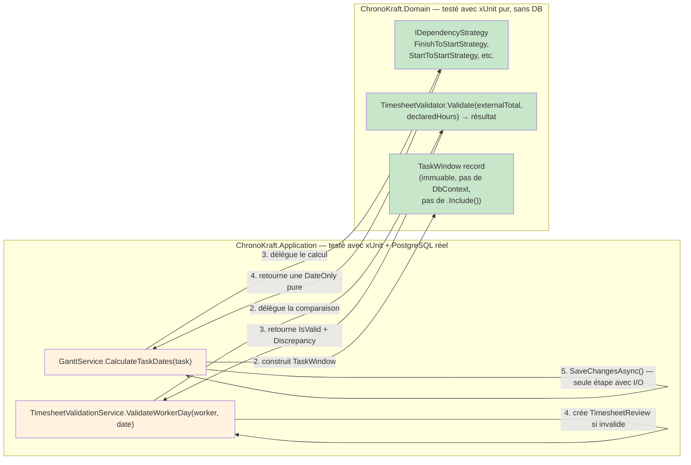
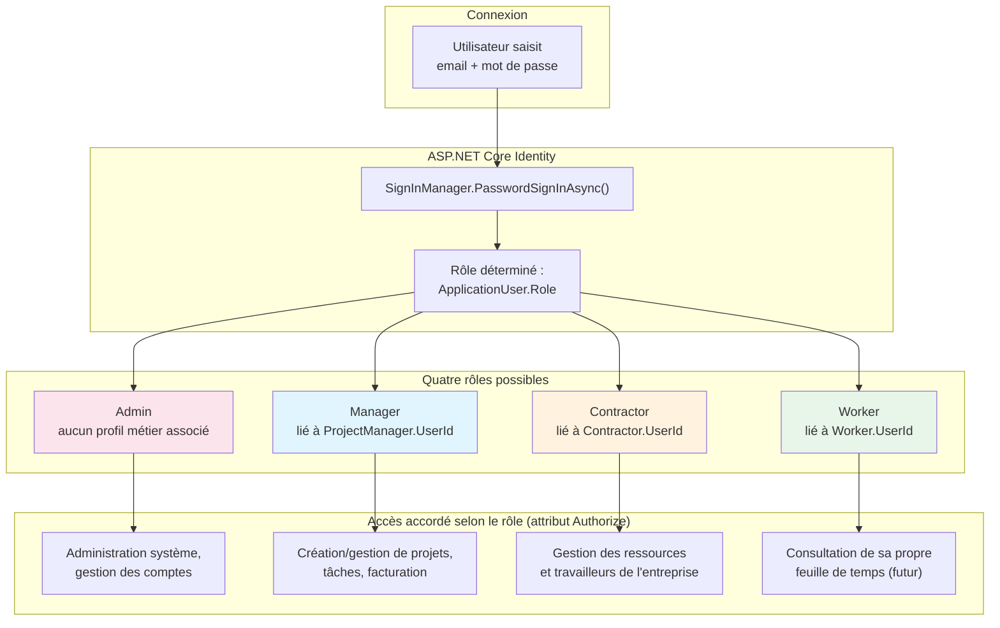
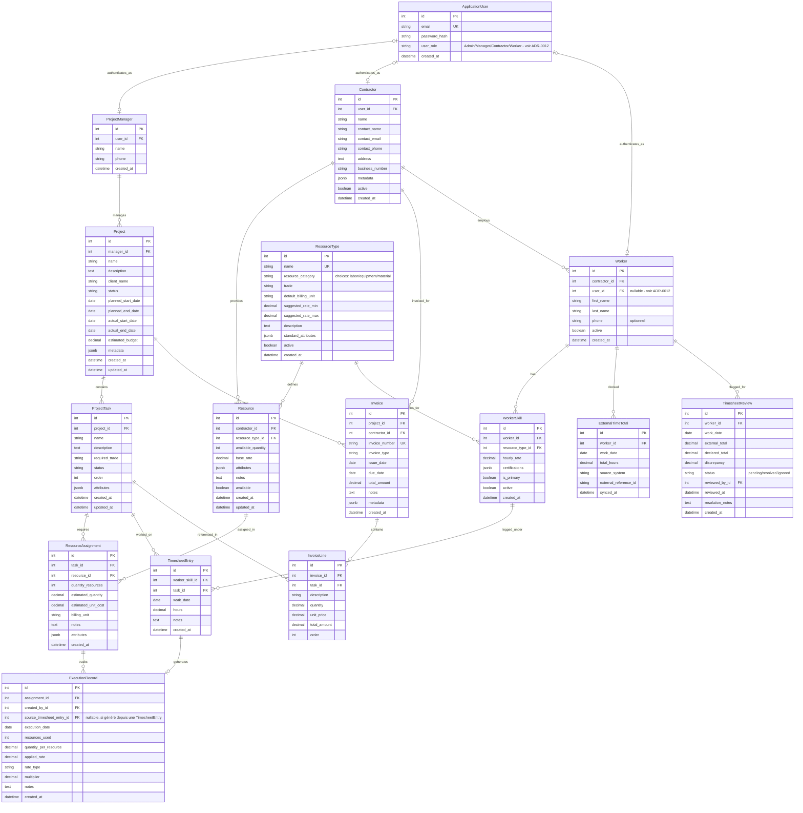
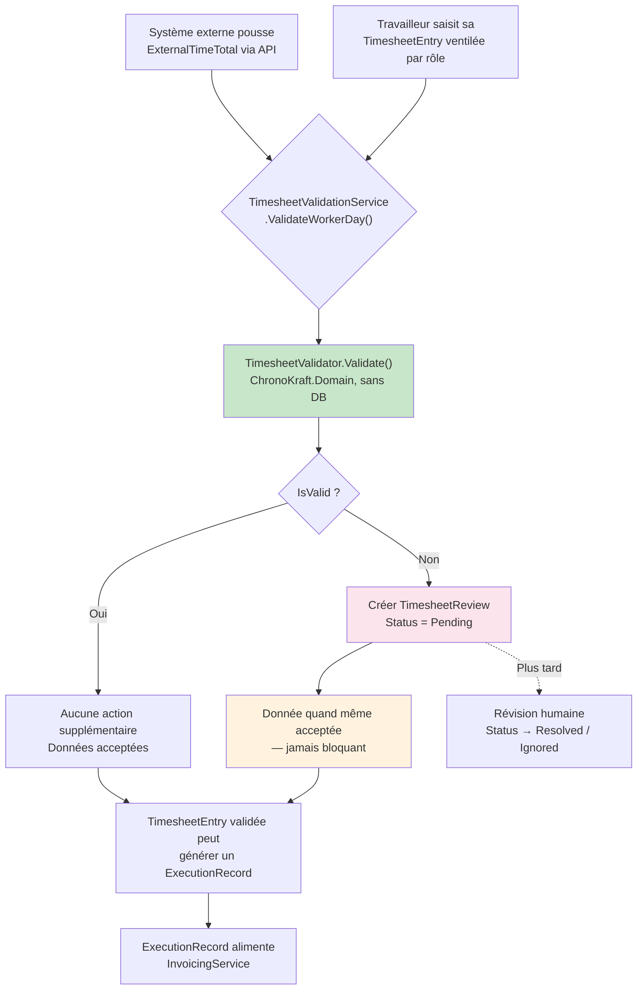

# ChronoKraft — Architecture

Système de gestion de projet avec planification Gantt, double saisie
web/Excel, suivi d'exécution et facturation. Construit sur ASP.NET Core
(.NET 10) avec Entity Framework Core et PostgreSQL.

Chaque section renvoie vers les ADRs (`adr/`) qui justifient les choix
présentés — ce document décrit le système tel qu'il est, les ADRs
expliquent pourquoi.

---

## Structure de Solution — Clean Architecture

La séparation entre logique de calcul pure et logique d'accès aux
données est imposée par le compilateur, via des projets .NET distincts
avec des références unidirectionnelles.

**Règle clé :** `ChronoKraft.Domain` ne référence aucun package externe
(pas d'EF Core, pas d'ASP.NET, pas d'Identity). Toute tentative d'y
importer une de ces dépendances provoque une erreur de compilation.

📄 ADR-0001, ADR-0003

---

## Architecture Globale

📄 ADR-0002, ADR-0003

---

## Séparation Domaine / Application

Les services de `ChronoKraft.Application` restent des adaptateurs
minces : ils lisent/écrivent via les repositories, puis délèguent tout
calcul à `ChronoKraft.Domain`.

**Bénéfices concrets :**
- Ajouter un type de dépendance Gantt = ajouter une classe
  `IDependencyStrategy`, aucune modification du code existant
- `ChronoKraft.Domain.Tests` s'exécute en millisecondes, sans base de
  données

📄 ADR-0003

---

## Authentification et Rôles

Quatre rôles : `Admin`, `Manager`, `Contractor`, `Worker`. Trois d'entre
eux se lient à une entité métier existante via une FK optionnelle
(`ProjectManager.UserId`, `Contractor.UserId`, `Worker.UserId`) ; `Admin`
n'a aucun profil métier associé.

**Limitation assumée :** un seul compte de connexion par entreprise
entrepreneur (`Contractor`), pas un compte par employé individuel.

📄 ADR-0012

---

## Modèle de Données — 15 Entités Métier + Identity

Schéma canonique — voir `data-model.mermaid` pour le fichier source
complet, reproduit ici pour référence directe.

Les champs auparavant susceptibles d'attributs dynamiques
(`metadata`, `attributes`, `standard_attributes`, `certifications`)
utilisent le type natif PostgreSQL `jsonb`, mappé directement sur des
`Dictionary<string, object>` en C# — aucune sérialisation manuelle
requise.

📄 ADR-0002, ADR-0005, ADR-0006, ADR-0007, ADR-0009, ADR-0012

---

## Flux de Réconciliation des Feuilles de Temps

Un système externe de pointage fournit un total d'heures par
travailleur/jour ; le travailleur déclare lui-même la ventilation par
rôle. Le système compare les deux, sans jamais bloquer en cas d'écart.

**Règles :**
- Le système ne détermine jamais automatiquement le rôle
- Une divergence est toujours acceptée, jamais bloquante
- Toute divergence est toujours tracée via `TimesheetReview`

📄 ADR-0008

---

## Interface Utilisateur

L'interface v0.1 utilise des **Razor Pages scaffoldées**, générées
directement à partir des entités Entity Framework Core
(`dotnet aspnet-codegenerator`). Une API REST (ASP.NET Core Web API +
Swashbuckle) est prévue en v0.2 pour découpler la logique métier de
l'interface de présentation.

📄 ADR-0001, ADR-0004
